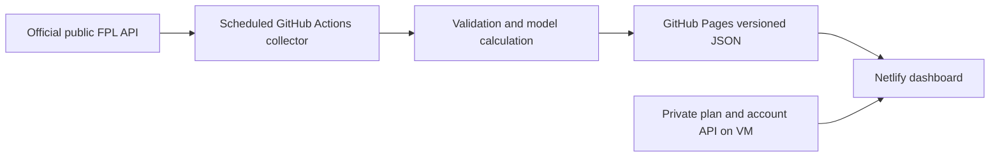

# Free scheduled public backend

Status (14 October 2026): **production cutover completed and HTTP smoke passed**.
The reviewed release tag is `v2026.10.14-free-static-data`, pinned to commit
`b4a26c94c73eaa44eff8e1e3e2f45a7a18d938fd`. Pages publication is
[GitHub Actions run 38558107001](https://github.com/lordirfan99/fpl/actions/runs/38558107001)
(attempt 2, success). Netlify production release is
[GitHub Actions run 38560579059](https://github.com/lordirfan99/fpl/actions/runs/38560579059),
deploy `6acf6f3507e7461b92e580fe`. Its live HTTP smoke returned 200 for
all 11 checked routes. Browser interaction and authenticated private flows
are not established by HTTP-only smoke; verify them separately.

The published dataset contained 1,193 + 2,539 complete manager entries, 28
checksum-verified files and all six frozen public journal records. Legacy
League 131997 archived snapshots for GW2, GW3, GW5 and GW6 were unavailable
during import and were omitted rather than inferred. Do not misrepresent its
older historical records as the latest GW. Both leagues' captured live
standings remain present. Private VM/API/bot services were not retired.

The reviewed default hourly schedule was enabled in PR #141; as of this
record, an ordinary scheduled execution has not yet been observed.

The owner selected strictly free scheduled data on 14 October 2026. This replaces
public dashboard API hosting with standard GitHub Actions runners and GitHub
Pages. The repository must remain public: GitHub charges standard runner minutes
for private repositories beyond their allowance. No Cloud Run, Cloud Scheduler,
paid worker, new database, GCS publication or always-on server is provisioned.
GitHub Pages has a 1 GB published-site limit and a soft 100 GB monthly bandwidth
limit; restrictions/failures at limits are not a service-level guarantee. The
publisher enforces 20 MiB per file, 250 MiB per generation and retains one prior
release. Use standard runners only. The existing Netlify website and existing
private VM services retain their own account limits/costs; this is a zero-cost
public data hosting design, not a promise that all existing infrastructure is free.

## Data flow

`publish-static-data.yml` collects hourly 07:17–23:17 UTC. GitHub cron is
best-effort; failures/delays retain the last successful deployment. A completed
collection of BOTH leagues is required. Data is captured, not real-time. The
12-hour stale threshold includes the planned overnight rest, but does not imply
live-score freshness. The dashboard recalculates source age at read time;
projections and current-team data fail unavailable when stale. Older finalized
archives remain accessible as historical research.

The dataset carries a content-addressed release directory and checksums for
every allowlisted file. Consumers verify full response bodies. A cached manifest
references an immutable release, and the predecessor is retained for deployment
transitions. Failed network/integrity reads are not cached as successes. The
manifest also lists finalized gameweeks, so standings/compare select the latest
available record without querying every older week through the VM.

Public files contain catalog, fixtures, V5 model projections, complete compact
leagues, public owner-event picks, recorded league evidence, public research and
frozen journal history. The builder never reads private dashboard/account files.
Public research always has account_state_verified=false, no actionable transfer
or captain lists, no plan and writes_enabled=false. Private packets and Telegram
approval remain on the current private backend and keep their existing guards.
No write scheduler or bot is launched by this migration.

Existing archives/journals are imported once from the already-public old API.
Unavailable league archives are omitted with a warning. Every journal record advertised by the legacy index must import successfully before first publication; a journal timeout blocks cutover. Outcomes are never invented.
Future finished, data-checked weeks are archived from a valid complete capture.
New journal outcomes without pre-deadline evidence are marked partial, rather
than presented as a model backtest. Frozen records keep original capture times.

## Publication and cutover

1. Merge the reviewed PR only after both CI jobs are green. Create an immutable
   `v2026.10.14-free-static-data` (or later reviewed) tag. Creating a `v*` tag
   normally triggers the web deployment, so use the existing release controls
   to prepare a tag without premature Netlify publication.
2. Enable GitHub Pages for `lordirfan99/fpl`, Source **GitHub Actions**. This is
   repository Settings → Pages → Build and deployment. The build workflow has
   only Pages/Actions/contents permissions and cannot grant itself repository
   administration to enable this setting.
3. Dispatch `publish · free public dataset` with the reviewed tag as
   `release_tag`. It verifies the tag is on main and has both required green
   checks, collects from public FPL and deploys only after validation. It needs
   no GCP identity, account secret or Pages API token.
4. Verify `https://lordirfan99.github.io/fpl/manifest.json`: correct revision,
   both league populations, SHA-256 for all files, capture times, archived index,
   and no private files. Check CSV, all journal pages and model inputs. Record
   missing legacy imports; do not claim those histories were migrated.
5. The scheduled publisher defaults to the reviewed immutable tag
   `v2026.10.14-free-static-data` without manual repository configuration.
   `FPL_STATIC_RELEASE_TAG` is an optional explicit override for a later reviewed
   release. Observe a successful ordinary scheduled run before retiring any
   redundant collector. Pinning the tag keeps unrelated main changes out.
6. Set Netlify production **server-only** `FPL_PUBLIC_DATA_URL` to
   `https://lordirfan99.github.io/fpl` (build and Functions scopes). Keep
   `FPL_API_BASE_URL` pointing to the existing private backend. Deploy the
   matching reviewed website tag. Never put the read token in a NEXT_PUBLIC var.
7. Verify all 13 dashboard pages, both leagues, search/paging/manager selection,
   journal links/CSV, mobile, stale input states and authenticated private-plan
   recovery. Confirm public browsing reads Pages and does not call the VM API.
8. After observing successful ordinary scheduled collections and private-flow
   checks, prepare a separate tagged VM change to retire only the redundant
   public collector timer. Keep the private API/account checker/planner/bot.
   Do not disable an unrelated shared VM service or manually edit runtime files.

## Rollback

Unset Netlify `FPL_PUBLIC_DATA_URL` and redeploy the previous reviewed web tag
(the original public API path remains compatible). Disable scheduled static
publication by unsetting `FPL_STATIC_RELEASE_TAG`. Pages can remain read-only;
do not delete frozen history to roll back. Restore any public collector timer
only if it was actually retired, using its prior tagged installer and recorded
prior state. No private bucket or approval rollback is required by this change.

## Remaining limitations

- Personal/private actions still depend on the VM; moving them requires a secure
  dynamic backend, not public static files.
- Public transfer optimizer is not executed on demand. Personal recommendations
  continue to require the verified private plan. Model/player/league research is
  precomputed from the public capture.
- An upstream FPL incident can delay new datasets. History remains readable;
  failed collection never becomes a new capture time.
- A tag must be updated/reviewed for a new season, tracked league or model change.
- Existing GCS scheduled archival jobs are not disabled by this PR; no existing
  paid service is removed until its replacement is verified.

Sources: https://docs.github.com/en/billing/concepts/product-billing/github-actions
and https://docs.github.com/en/pages/getting-started-with-github-pages/github-pages-limits
